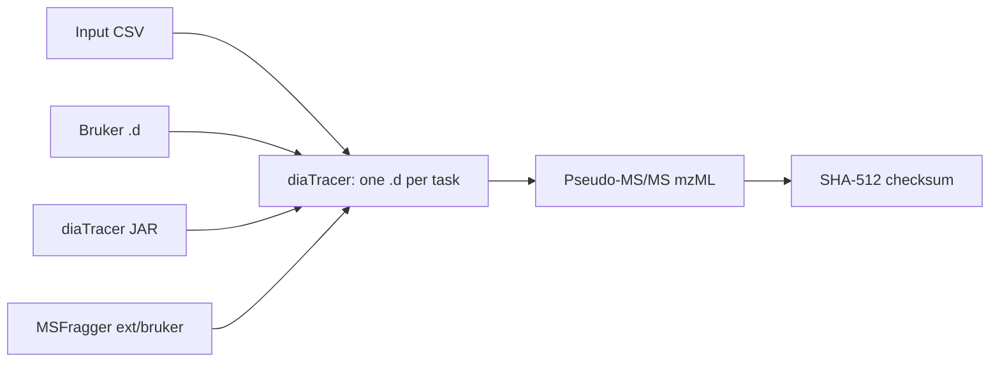

# pipeline-reconstruct-ProteomicMSMS

- [Overview](#overview)
- [How To Run](#how-to-run)
- [Pipeline Steps](#pipeline-steps)
- [Inputs](#inputs)
  - [Input CSV](#input-csv)
  - [Config](#config)
- [Outputs](#outputs)
- [Resources](#resources)
- [Testing and Validation](#testing-and-validation)
- [References](#references)
- [License](#license)

## Overview

This Nextflow DSL2 pipeline reconstructs pseudo-MS/MS spectra from Bruker dia-PASEF `.d` acquisitions with diaTracer. It processes each acquisition independently, including separate fractions of the same sample, and publishes one mzML and SHA-512 checksum per run. The original `.d` directories remain available for downstream DIA quantification.

## How To Run

1. Initialize the repository's Git submodules with `git submodule update --init --recursive`. Copy [config/template.config](config/template.config) to a run-specific config. Set `dataset_id`, `input_csv`, `diatracer_executable`, `bruker_lib_dir`, and `output_dir`.

2. Obtain the diaTracer JAR and the compatible MSFragger `ext/bruker` directory under their licenses. diaTracer 2.2.1 requires `libtimsdata-2-21-0-4.so` in that directory. Create an input CSV using [input/input.csv](input/input.csv), with one `.d` acquisition per row.

3. Run the pipeline:

   ```bash
   export NXF_VER=25.10.5
   export NXF_SYNTAX_PARSER=v1
   nextflow run . -c my-run.config
   ```

The `standard` and `docker` profiles use Docker; use `-profile apptainer` where appropriate. The default image is assembled from `fragpipe_docker_repo = 'fcyucn/fragpipe'` and `fragpipe_version = '24.0'`. Set `work_dir` to scratch with enough space for copies of the `.d` acquisitions. The [`.env-template`](.env-template) records the Nextflow version and parser used by the shared pipeline configuration.

## Pipeline Steps



`reconstruct_msms_diaTracer` copies each `.d` directory to its task directory, stages the supplied JAR and Bruker libraries, and writes a standardized `<sample_name>_<fraction_id>_diatracer.mzML`. It requires exactly one generated mzML. `calculate_SHA512` writes its checksum sidecar. Separate CSV rows can run in parallel within the allocated resources.

## Inputs

### Input CSV

The CSV requires these columns and may include additional columns, which the pipeline ignores:

| Field | Required | Description |
| ----- | -------- | ----------- |
| `sample_name` | yes | Biological sample identifier; may occur on several fraction rows. |
| `fraction_id` | yes | Fraction or acquisition identifier within a sample. Use `1` for an unfractionated run. |
| `path` | yes | Existing Bruker dia-PASEF `.d` directory. Relative paths resolve from the CSV directory. |

```csv
sample_name,fraction_id,path
sample_01,1,/data/sample_01.d
sample_01,2,/data/sample_01_fraction_2.d
```

Sample and fraction identifiers must start with a letter or digit and contain only letters, digits, `_`, or `-`. Each `(sample_name, fraction_id)` pair, `.d` path, and generated output basename must be unique. The pipeline checks the `.d` directory name but does not infer the acquisition mode from its contents.

### Config

| Parameter | Type | Description |
| --------- | ---- | ----------- |
| `dataset_id` | string | Identifier for the output subdirectory. |
| `input_csv` | path | CSV of `sample_name`, `fraction_id`, and `.d` path. |
| `diatracer_executable` | path | Separately obtained diaTracer JAR. |
| `bruker_lib_dir` | path | Compatible MSFragger `ext/bruker` directory containing the Bruker Linux library. |
| `output_dir` | path | Root output directory. |
| `work_dir` | path | Optional Nextflow work directory; otherwise uses `NXF_WORK` or `work` under the launch directory. |
| `fragpipe_docker_repo` | string | FragPipe image repository; default `fcyucn/fragpipe`. |
| `fragpipe_version` | string | FragPipe image tag; default `24.0`. |
| `diatracer_*` | number | diaTracer options, including `write_inter`, `delta_apex_im`, `delta_apex_rt`, `ms1_ms2_corr`, `mass_defect_filter`, `mass_defect_offset`, and `rf_max`. |
| `base_resource_update` | namespace | Optional per-process CPU and memory adjustments. |

The diaTracer option defaults are in [config/default.config](config/default.config), and the validation rules are in [config/schema.yaml](config/schema.yaml). The effective parameters are saved under the run's `nextflow-log/params.json`.

## Outputs

Results are written under `<output_dir>/reconstruct-ProteomicMSMS-1.0.0/<dataset_id>/`:

| Output | Description |
| ------ | ----------- |
| `output/diaTracer/<sample_name>_<fraction_id>_diatracer.mzML` | Reconstructed pseudo-MS/MS spectra. |
| `output/diaTracer/<mzML name>.sha512` | SHA-512 checksum, compatible with `sha512sum -c`. |
| `log-reconstruct-ProteomicMSMS-1.0.0-<timestamp>/` | Process logs, Nextflow trace, report, timeline, and effective parameters. |

The mzML can be searched as DDA spectra and used in spectral-library generation. Keep the original `.d` acquisition for DIA-NN quantification.

## Resources

[config/resources.json](config/resources.json) defines the initial allocations:

| Process | CPUs | Memory |
| ------- | ---- | ------ |
| `reconstruct_msms_diaTracer` | 12 | 64 GB |
| `calculate_SHA512` | 1 | 1 GB |

The shared resource handler caps requests at available resources. diaTracer can retry with increased memory after a retryable failure, subject to that cap. Use `base_resource_update` to adjust allocations for a run.

## Testing and Validation

The [nf-test integration case](test/README.md) processes one representative dia-PASEF `.d` acquisition with a locally supplied diaTracer JAR and MSFragger Bruker libraries. Set `TEST_DATA_DIR` in a local `.env` based on [`.env-template`](.env-template), then run `bash test/run-nftest.sh test-integration-diaTracer` in the supported cluster environment. The runner retains output and work files under `/scratch` for inspection. End-to-end completion and scientific validation have not yet been established for version 1.0.0.

## References

1. Li et al. diaTracer enables spectrum-centric analysis of diaPASEF proteomics data. *Nature Communications*, 16, 95 (2025). [doi:10.1038/s41467-024-55448-8](https://doi.org/10.1038/s41467-024-55448-8)
2. [diaTracer documentation](https://diatracer.nesvilab.org/) and [FragPipe documentation](https://fragpipe.nesvilab.org/).

## License

The code in pipeline-reconstruct-ProteomicMSMS is licensed under the
BSD 3-Clause License (`BSD-3-Clause`). See [LICENSE](LICENSE) for the terms.

Shared code and third-party tools retain their respective licenses.

Copyright (C) 2026 Sanford Burnham Prebys Medical Discovery Institute ("Boutros Lab")
